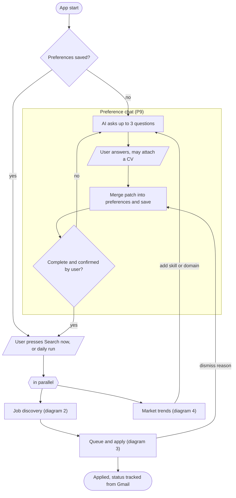
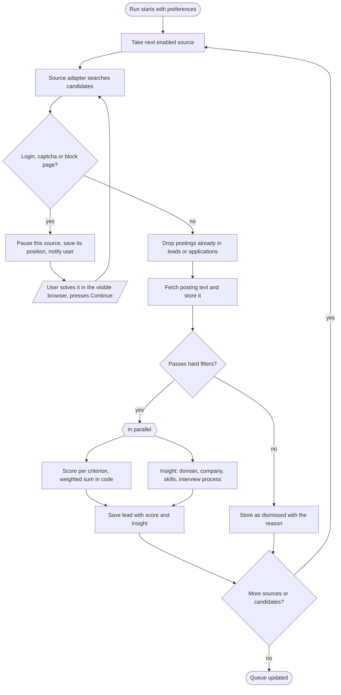
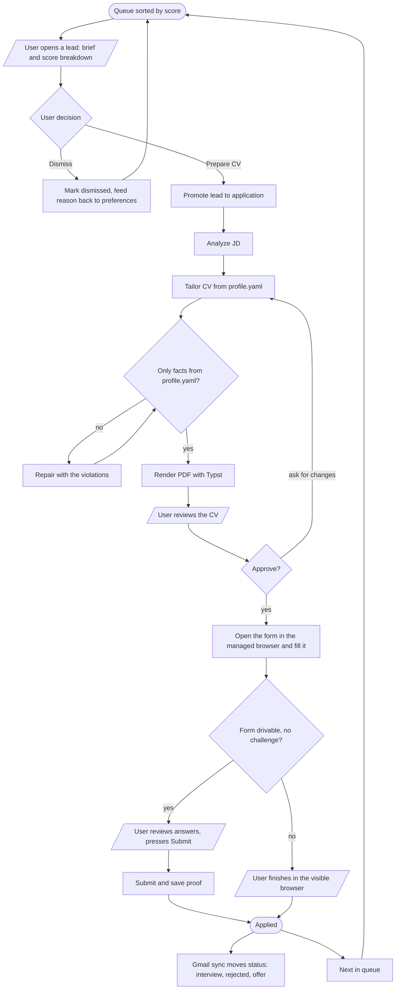
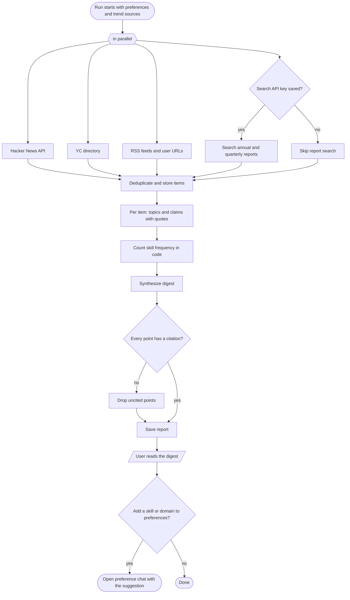

# Activity diagrams for P8-P13

Status: **draft**.

"Graph engineering" is read here as: each feature is a **graph of small steps over a typed state**, with conditional edges, parallel branches, and **interrupt nodes** where the run stops and waits for the user. The diagrams below are those graphs.

Legend: rounded = start/end, box = step done by the app, slanted = **interrupt, the user acts**, diamond = decision, hexagon = branches run in parallel.

## 1. Overview

## 2. Job discovery (P10 + P11)

Other sources keep running while one waits at the interrupt.

## 3. Queue, CV and apply (P12 + existing pipeline and apply flow)

## 4. Market trends (P13)

A challenge on a trend source uses the same interrupt as diagram 2.

## How this maps to code

| Graph concept | In JobPilot |
|---------------|-------------|
| State | One typed struct per graph (`ChatState`, `DiscoveryState`, `ApplyState`, `TrendState`), saved in SQLite after every node |
| Node | An async function `state -> state`, run through `runtime::spawn`; no UI code inside |
| Edge | A plain Rust `match` on the state; the LLM fills state fields, it never picks the next node or a URL |
| Parallel branch | Tasks joined before the next node (score + insight, trend sources) |
| Interrupt | A node that saves the state and returns `WaitingForUser`; the UI shows the one primary button, and resuming reloads the state |
| Retry | A failed node keeps the last saved state; Retry re-runs that node only |

Proposed change to P8, not yet written into the P8 plan: add a small `core/graph` module (node trait, runner, checkpoint table) so P9-P13 share one runner instead of four hand-written loops. The existing `pipeline::generate` and `apply::flow` already follow this shape (stages, hand-off) and can move onto the runner later.
